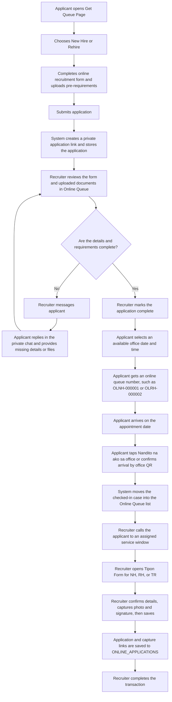

# Online Recruitment Application Process

This process keeps online applicants in a separate queue until they confirm arrival, so online appointments do not affect walk-in queue order.

## Queue handling

- The online queue number is issued after the recruiter approves the requirements and the applicant books an appointment.
- Online applicants remain separate from walk-in applicants until they confirm arrival.
- Online queue numbering continues as applicants book; the prefix identifies the transaction (for example, `OLNH` or `OLRH`).
- Recruiter and applicant messages stay in the private application conversation while the application is being reviewed.
- The Tipon Form action is available only for New Hire, Rehire, and Transfer transactions.
